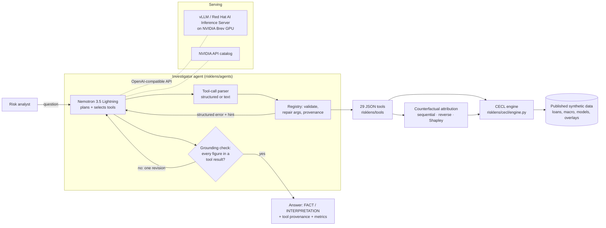

# RiskLens AI — CECL Allowance Investigator

**Explain every dollar of credit loss.**

Built at the **NVIDIA × Red Hat Small Models Hack** (Raleigh, October 17–18, 2026).

Banks can calculate their CECL credit-loss allowance. Explaining *why it moved* is still a manual, multi-team exercise: Finance, Credit Risk, Model Risk and economists each pull their own numbers and try to make them add up. RiskLens puts a small open model (**NVIDIA Nemotron 3.5 Lightning, 30B total / ~3B active**) in front of 29 deterministic risk-analytics tools. The model plans the investigation, picks the tools, recovers from bad calls and writes the explanation. The tools do every calculation. Every figure in an answer is checked against the tool results before it is shown, and the driver attribution reconciles to the booked allowance to the cent.

| | |
|---|---|
| **Challenge track** | 🛠️ **Tool-Calling**: one small model that uses real tools reliably |
| **Bounties** | Best Use of NVIDIA Nemotron Lightning · Best Use of Red Hat vLLM |
| **Model** | `nvidia/NVIDIA-Nemotron-3.5-Lightning-30B-A3B` (30B total parameters, within the 33B limit) |
| **Serving** | vLLM on NVIDIA Brev (`deploy/brev_serve_nemotron.sh`) or the NVIDIA API catalog |
| **Data** | Synthetic, seeded, published in [`data/published/`](data/published) with full methodology in [`docs/DATA.md`](docs/DATA.md) |
| **Demo video** | _add unlisted YouTube/Vimeo link_ |

---

## What it answers

The demo compares the July and August 2026 month-ends of a synthetic $8.1B bank loan book (50,000 loans).

```
$ python -m scripts.report
Allowance 2026-07-31: $101.58M -> 2026-08-31: $121.12M  (+$19.54M, 19.2%)

Driver                                  Sequential       Reverse       Shapley
Macroeconomic scenario changes            +$12.63M      +$12.23M      +$12.44M
Credit deterioration                       +$5.82M       +$6.60M       +$6.21M
Portfolio growth                           +$2.68M       +$3.02M       +$2.85M
Model / methodology & judgment             +$1.76M       +$1.45M       +$1.60M
Paydowns / runoff                          -$3.35M       -$3.76M       -$3.55M

Reconciliation: residual $0.01 -> PASS (primary driver stable across methods: True)

By portfolio: CRE +$10.38M, C&I +$5.11M, Credit Card +$1.66M, Auto +$0.85M, Consumer +$0.80M, Mortgage +$0.75M
Macro by variable: unemployment_rate +$6.64M, cre_price_growth +$2.63M, gdp_growth +$2.52M, interest_rate +$0.64M
Top borrowers: CP_046990 +$1.11M; CP_046995 +$0.55M; CP_047007 +$0.50M
Model versions changed: False
```

Typical questions: *Why did the allowance increase? Which borrowers should I investigate? Which macro variable mattered most? What happened in CRE? Could this just be a model change? Does everything reconcile?* The agent answers in `FACT:` / `INTERPRETATION:` lines, so it's clear what came from a tool and what is the model's reading of it.

---

## Quick start

Python 3.10+. No GPU or API key is needed for the offline path.

```bash
git clone https://github.com/Luizkauffmann/Nvidia-Redhat-RiskLens.git
cd Nvidia-Redhat-RiskLens
pip install -r requirements.txt

python -m scripts.precompute        # ~60 s once: warms the attribution cache (data is already in data/published)
python -m scripts.report            # the demo story, straight from the tools (no LLM)
python -m scripts.ask "Why did our allowance increase in August?" --trace   # offline planner, no model
python -m pytest -q                 # 35 tests
```

To regenerate the synthetic data from scratch (reproducible from the seed: same loans, same figures):

```bash
python -m scripts.generate_data     # ~15 s data + ~60 s cache
```

## Reproduce the demo with Nemotron

Copy `.env.example` to `.env` (or export the variables) and pick a backend.

**Option A — NVIDIA API catalog** (fastest to try)

```bash
export NVIDIA_API_KEY=nvapi-...          # from build.nvidia.com
python -m scripts.check_llm --provider nvidia               # smoke test: one chat turn + one tool call
python -m scripts.ask "Which borrowers should I investigate?" --provider nvidia --trace
```

**Option B — Red Hat vLLM on an NVIDIA Brev GPU** (self-hosted, data never leaves the instance)

```bash
# on the Brev instance (1x H100 or similar)
bash deploy/brev_serve_nemotron.sh                         # vLLM, OpenAI API + tool calling on :8000

# wherever the app runs
export RISKLENS_LLM_PROVIDER=vllm
export RISKLENS_LLM_BASE_URL=http://<brev-host>:8000/v1
python -m scripts.ask "Does everything reconcile?" --provider vllm --trace
python -m scripts.evaluate --provider vllm                  # 15 demo questions scored against ground truth
```

| Variable | Purpose | Default |
|---|---|---|
| `RISKLENS_LLM_PROVIDER` | `mock`, `nvidia`, `vllm` or `openai` | `mock` |
| `NVIDIA_API_KEY` | key for the NVIDIA API catalog | none |
| `RISKLENS_LLM_BASE_URL` | OpenAI-compatible endpoint (vLLM on Brev, NIM) | per provider, see `config/agents.yaml` |
| `RISKLENS_LLM_MODEL` | model id override | `nvidia/nemotron-3.5-lightning-30b-a3b` (API), `nemotron-3.5-lightning` (vLLM) |
| `RISKLENS_LLM_API_KEY` | key for other endpoints | none (`EMPTY` for vLLM) |
| `RISKLENS_DATA_DIR`, `RISKLENS_OUTPUT_DIR` | data / log locations | `data/published`, `data/outputs` |

Model ids on the API catalog change from time to time. If `check_llm` returns a 404, look up the current id on build.nvidia.com and set `RISKLENS_LLM_MODEL`.

---

## Architecture



**Golden rule:** the model reasons, routes and explains; deterministic Python does every calculation. The model never sees raw data, only tool results.

| Layer | What it does | Where |
|---|---|---|
| CECL engine | Lifetime ECL = Σ scenarios × Σ years (marginal PD × LGD × EAD); PD from per-model scorecards plus a macro logit shift; LGD tied to collateral prices; amortising / bullet / revolving exposure profiles; overlays | `risklens/cecl/engine.py` |
| Attribution | Re-runs the engine for counterfactual states (one input group moved at a time). The sequential waterfall telescopes exactly; reverse order and exact Shapley show order sensitivity; macro is split by variable with exact Shapley | `risklens/cecl/attribution.py` |
| Tools | 29 functions returning JSON. Validation, argument repair (`"cre"` → `CRE`, `"Aug 2026"` → `2026-08-31`), structured errors with recovery hints, provenance (call id, args, timestamp, sha256 of result) | `risklens/tools/` |
| Agent | Tool loop with text-call parsing (Qwen3-coder XML, `<tool_call>` JSON, fenced JSON), duplicate suppression, result compaction, grounding check + one revision, deterministic fallback, run metrics | `risklens/agents/agent.py`, `grounding.py` |
| LLM providers | One interface; NVIDIA API, vLLM, any OpenAI-compatible endpoint, or the offline mock planner | `risklens/llm/` |
| Config | All tunables in YAML: methodology, model parameters, injected story, reconciliation thresholds, agent limits | `config/` |

Details and design decisions: [`docs/ARCHITECTURE.md`](docs/ARCHITECTURE.md).

**Tech stack:** Python 3.10+, numpy, pandas, pyarrow, PyYAML, `openai` client (for OpenAI-compatible endpoints), pytest. Model: NVIDIA Nemotron 3.5 Lightning. Serving: vLLM (Red Hat AI Inference Server engine) on NVIDIA Brev, or the NVIDIA API catalog.

### Tools the model can call

| Area | Tools |
|---|---|
| Shared | `get_reporting_context`, `get_allowance_summary`, `compare_allowance`, `get_portfolio_snapshot` |
| Portfolio | `calculate_balance_change` (exact bridge), `calculate_new_originations`, `calculate_paydowns`, `calculate_ead_change`, `calculate_segment_attribution`, `calculate_portfolio_attribution` |
| Credit | `calculate_pd_migration` (scorecard vs macro PD), `calculate_lgd_migration`, `calculate_rating_migration`, `identify_top_contributors` (reason codes), `get_loan_details`, `get_counterparty_details`, `compare_borrower_periods` (PD logit by feature) |
| Macro | `compare_macro_scenarios`, `compare_scenario_weights`, `calculate_macro_attribution`, `calculate_variable_attribution` (exact Shapley), `run_scenario_analysis` (what-if weights), `calculate_segment_macro_sensitivity` |
| Model risk | `compare_model_versions`, `compare_model_parameters`, `compare_management_overlays`, `get_model_metadata` |
| Reconciliation | `calculate_allowance_attribution` (sequential / reverse / Shapley), `reconcile_allowance_change` (residual, % explained, PASS / WARNING / FAIL, robustness) |

### Why this suits a small model

A 3B-active model doesn't need to know CECL math; it needs to pick the right tool and copy the numbers faithfully. The system makes that easier and checks it:

- **Narrow, typed tools** with one-line descriptions and enums, so the choice is clear.
- **Forgiving arguments**: dates, portfolio names and argument-name typos are repaired; the repair is logged.
- **Errors that teach**: `{"error": "Unknown reporting date '2025-01-31'", "hint": {"available_dates": [...]}}`, so the model can retry correctly.
- **Text tool calls accepted**: if the model writes a call as text instead of a structured call, it is parsed rather than lost.
- **Grounding check**: numbers in the answer are parsed with units ($M, %, pp) and matched to tool results within display rounding. Unsupported figures trigger one revision turn; if the model still can't finish, a deterministic summary of the tool results is returned.
- **Metrics per run** (`AgentRun.metrics()`): tool calls, success rate, argument validity, repairs, errors recovered, text-parsed calls, duplicates, grounding revisions, fallbacks, tokens, latency.

### Evaluation

`scripts/evaluate.py` asks the 15 demo questions and scores each answer against the hidden ground truth (`data/published/ground_truth.json`, which tools and agents never read; a test enforces this): did it select a tool that can answer, does the answer contain the expected fact, is every figure grounded.

| Provider | Tool selected | Answer correct | Grounded |
|---|---:|---:|---:|
| Offline keyword planner (pipeline check) | 15/15 | 15/15 | 15/15 |
| Nemotron 3.5 Lightning via vLLM on Brev | _run `python -m scripts.evaluate --provider vllm`_ | | |

The offline row validates the tools, attribution and grounding pipeline; it is not a model score. Results for each run are written to `data/outputs/eval_<provider>.json`.

---

## Data and provenance

All data is **synthetic**, generated by [`risklens/data/generator.py`](risklens/data/generator.py) from the seed in `config/settings.yaml` and the story in `config/story.yaml`. No real borrower, bank or market data is used. The generated files are committed in [`data/published/`](data/published), with CSV samples in `data/published/samples/` and SHA-256 checksums in `SHA256SUMS.json`.

| File | Contents |
|---|---|
| `loans_2026-07-31.parquet`, `loans_2026-08-31.parquet` | 50,000 / 51,798 loans: product, portfolio, balances, terms, FICO/DTI/LTV (retail), rating/DSCR/LTV/leverage (commercial), delinquency, model ids, and the booked PD, LGD, EAD and ECL |
| `counterparties.parquet` | 50,508 counterparties: 45,060 retail customers and 5,448 commercial companies (invented names) |
| `macro_scenarios.csv` | 6 variables × 3 scenarios × 12 quarters × 2 forecast vintages, with scenario weights |
| `model_metadata.csv` | Model registry (PD, LGD, EAD models; one CRE model in validation) |
| `management_overlays.csv`, `run_manifest.json` | Overlays and the booked official run per date |
| `ground_truth.json` | What was injected (evaluation only) |

The injected story: worse macro forecasts (unemployment up most, CRE prices down), 20 CRE office/retail borrowers deteriorating (PD ~1.8% → ~5.5%, rating downgrades, lower DSCR, higher LTV), $40M of new CRE plus other originations, normal runoff, scenario weights shifted toward severe (10% → 12%), and **no model change**. Full data card and methodology: [`docs/DATA.md`](docs/DATA.md).

---

## Known limitations

- **Live model results are not in this README yet.** The full pipeline is tested offline (35 tests) and with scripted fake models that make the typical mistakes. Fill the evaluation table from `scripts/evaluate.py` once Nemotron is running on Brev.
- **Single agent.** One model with all 29 tools (Tool-Calling track). Per-specialist tool allow-lists already exist in `config/agents.yaml` but are not wired into a multi-agent orchestrator.
- **Command-line interface only.** No web UI yet.
- **Simplified CECL engine.** Annual time steps, undiscounted lifetime loss, straight-line amortisation, constant prepayment, logistic scorecards with a linear macro shift. Transparent and easy to audit, not a production model.
- **Attribution order is a choice.** The sequential waterfall is exact but order-dependent; reverse-order and Shapley values are reported next to it, and reconciliation warns if the primary driver changes across methods.
- **Synthetic data**, with one designed story. Real portfolios are messier.
- **First-call latency.** The Shapley attributions need ~100 engine runs (~60 s) the first time; results are cached on disk (`scripts/precompute.py`).

## Next steps

1. Run and publish the Nemotron evaluation on Brev; compare thinking on/off and NVFP4 vs BF16.
2. Split into specialist agents (Portfolio, Credit, Macro, Model Risk, Reconciliation) using the existing allow-lists, with the reconciliation agent challenging the others' claims.
3. Streamlit UI: KPIs, waterfall, chat with tool trace and grounding badges.
4. Use the tool-call logs as training data: fine-tune with NVIDIA NeMo Gym for tool selection and argument accuracy.
5. GPU dataframes (RAPIDS cuDF) for the counterfactual re-runs on larger books.

---

## Team

| Name | Role | Contact |
|---|---|---|
| Luiz Kauffmann | Lead: architecture, CECL analytics, agent | _add contact_ |
| _add teammate_ | | |

## Hackathon provenance

The rules require that code needed to run is written during the event. **All code in this repository was written on October 17–18, 2026**, starting from an empty repository (see the commit history). Before the event we did planning work: the project concept, the CECL methodology design, and the scenario parameters for the synthetic story (product mix, macro paths, scenario weights, overlays), some of which are reused here as configuration values. An earlier private prototype informed the design; no code from it was copied into this repository.

## License

Apache-2.0 (see [`LICENSE`](LICENSE)).
