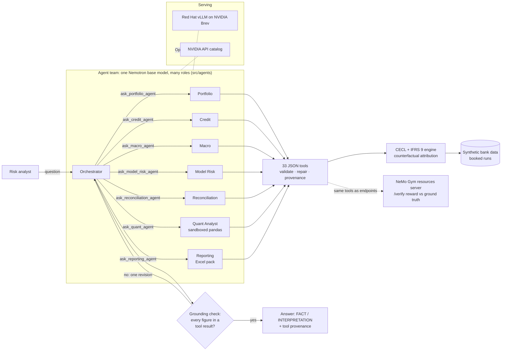

# RiskLens AI: Multi-Agent CECL Investigator

*Explain every dollar of credit loss.* Built for the NVIDIA × Red Hat Small Models Hack.

Specialized small-model agents investigate why the credit-loss allowance moved. They call deterministic analytics tools and never invent numbers. The repo has synthetic data, a CECL + IFRS 9 engine with separate PD / LGD / EAD models per product, an attribution that reconciles exactly, **33 JSON tools**, an orchestrating agent that runs on Nemotron 3.5 Lightning (local vLLM / Brev or the NVIDIA API), and a **NeMo Gym environment** that scores investigations against the seeded ground truth.

> **Provenance.** Pre-hackathon work (engine, data, tools, Phase 3 agent) was imported in one commit from `Luizkauffmann/risklens-cecl`; everything after that commit was built during the hackathon. See `git log`.
>
> **New to the team?** Start with [`docs/PROJECT_ARCHITECTURE.md`](docs/PROJECT_ARCHITECTURE.md), then [`docs/NEMO_GYM.md`](docs/NEMO_GYM.md).

| Submission | |
|---|---|
| **Team** | Residual Zero |
| **Challenge track** | 🕸️ Multi-Agent Systems (with heavy Tool-Calling instrumentation) |
| **Bounties** | Best Use of NVIDIA Nemotron Lightning · Best Use of Red Hat vLLM · Best Model Improvement With NVIDIA NeMo Gym |
| **Model** | NVIDIA Nemotron 3.5 Lightning, 30B total / ~3B active (within the 33B limit); one shared base model for every agent |
| **Serving** | Red Hat vLLM on NVIDIA Brev (`deploy/brev_serve_nemotron.sh`) or the NVIDIA API catalog |
| **Data** | Synthetic and seeded, published in [`data/published/`](data/published); data card in [`docs/DATA.md`](docs/DATA.md) |
| **Demo video** | _add unlisted YouTube/Vimeo link_ |

## Quick start (local)

```bash
# Core analytics + agent (Python >= 3.10)
pip install -r requirements.txt
python -m scripts.generate_demo_data     # ~20 s: data + official runs + ground truth
python -m scripts.precompute_analytics   # ~75 s once: warms attribution + Shapley cache
python -m pytest                         # ~3 min (also run in GitHub Actions)

# Full setup with NeMo Gym + notebooks (Python >= 3.13.14, required by nemo-gym)
uv venv --python 3.13 .venv && source .venv/bin/activate
uv pip install -r requirements-gym.txt
jupyter lab notebooks/
```

```python
from src.tools import call_tool
r = call_tool("compare_allowance", {"previous_date": "July 2026", "current_date": "2026-08"})
r.result["change"]      # 19238021.81  (dates are normalised to 2026-07-31 / 2026-08-31)
r.provenance()          # call_id, tool_name, parameters, timestamp, result_sha256
```

## Offline demo app (no Excel needed)

`demo_app/` serves the attribution pack in the browser on localhost: the same nine tool calls and the same eight sheets as the Excel pack (Summary, Waterfall, Portfolio x driver, Macro variables, Top borrowers, Models and weights, Reconciliation, Sources), with the same colour code. Hover a cell to see its formula or source; click a tool output to jump to its call in Sources. An **Ask RiskLens** panel runs the agent team (or the single orchestrator) and shows the answer, grounding status and tool trace. Nothing is loaded from the internet.

```bash
python -m demo_app.server                    # http://127.0.0.1:8050 (mock planner: no model needed)
# Local model: pick "Local Ollama" in the panel (Ollama on :11434), or a vLLM endpoint URL
```

| Endpoint | What it does |
|---|---|
| `GET /api/pack?previous_date=&current_date=&framework=` | the pack as JSON (cells carry kind, format, formula or source call_id) |
| `POST /api/ask` | `{question, mode: team\|orchestrator, provider, base_url, model}`: answer + grounding + tool calls |
| `POST /api/tool` | call any registered tool directly (for wiring new agents) |
| `GET /api/export.xlsx` | the original Excel pack, for anyone with a spreadsheet app |

## Notebooks (run locally; Colab still works)

Start Jupyter from the repo root. Each notebook finds the checkout, generates the seeded data if `data/` is empty, and reads secrets from `.env` (copy `.env.example`). In Colab the same first cell clones the repo instead. Notebooks are generated by `python -m scripts.build_notebooks`; edit that script, not the `.ipynb`.

| Notebook | What it does | Needs |
|---|---|---|
| `01_CECL_Workflow.ipynb` | The bank's traditional month-end run: source extracts, pre-run controls, official CECL + IFRS 9 runs with a run log, then the movement analysis (waterfall, segments × drivers, macro Shapley, top borrowers, reconciliation) using the agents' tools | CPU only |
| `02_Agent_Investigator.ipynb` | Ask Nemotron why the allowance moved: answer, grounding badge, full tool trace, and the **NeMo Gym reward** for each demo question | vLLM (local/Brev) or `NVIDIA_API_KEY`; `mock` works offline |
| `03_NeMo_Gym_Environment.ipynb` | The RiskLens NeMo Gym environment: dataset, reward function by example, mock baseline in-process and through real Gym servers, Nemotron rollouts, policy comparison, export of passing rollouts as SFT data | `nemo-gym` (Python ≥ 3.13.14); Nemotron endpoint for section 5 |

## The RiskLens team (multi-agent)

`src/agents/team.py`: an orchestrator delegates through `ask_<specialist>` tools. Every role is the same Nemotron model (one base keeps the system within 33B) with its own prompt and tool allow-list (`config/agents.yaml`).

| Agent | Owns | Tools |
|---|---|---|
| Orchestrator | plan, delegate, combine, final grounding check | `ask_*`, attribution, compare |
| Portfolio / Credit / Macro / Model Risk | exposure; borrower deterioration; scenarios; models, weights, overlays | 12–15 each |
| Reconciliation | PASS / WARNING / FAIL, order robustness | 11 |
| **Quant Analyst** | custom questions via pandas in a read-only sandbox (`run_python_analysis`: no network, no writes, no ground truth, 60 s limit; the code is logged with its hash) | 5 |
| **Reporting Analyst** | Excel attribution pack (`build_attribution_workbook`): live formulas, Sources sheet with every tool call | 4 |

```python
from src.agents.team import build_team
run = build_team(provider).run("Which borrowers should I investigate, and does it reconcile?")
```

## NeMo Gym environment

`resources_servers/risklens_cecl/` is a standard NeMo Gym resources server: the 30 tools are `POST /<tool>` endpoints and `/verify` returns a reward plus `reward_components` (correctness vs ground truth, numeric grounding, tool selection, call validity, efficiency). Details and design choices: [`docs/NEMO_GYM.md`](docs/NEMO_GYM.md).

```bash
python -m scripts.build_gym_dataset                       # example / train / validation JSONL
# offline: the mock planner behind an OpenAI-compatible endpoint
python -m scripts.serve_policy --provider mock --port 8011 &
gym env start --resources-server risklens_cecl --model-type vllm_model \
    --model mock-planner --model-url http://127.0.0.1:8011/v1 --model-api-key none
gym eval run --no-serve --agent risklens_cecl_simple_agent \
    --input resources_servers/risklens_cecl/data/example.jsonl --output data/outputs/gym/mock.jsonl
# Nemotron: same commands with --model nvidia/NVIDIA-Nemotron-3.5-Lightning-30B-A3B-NVFP4 --model-url http://localhost:8000/v1
```

Mock planner baseline through real Gym servers: mean reward **0.965** on the 21 train rows (it fails paraphrases it has no keyword for). That is the floor Nemotron has to beat.

## Ask the agent (Phase 3)

One orchestrating agent (`src/agents/orchestrator.py`) plans the investigation and calls the tools. Its answer then goes through a **grounding check**: every number must appear in a tool result from that run. Otherwise the agent gets one revision turn, naming the unsupported figures.

```bash
python -m scripts.ask "Why did the allowance increase?" --trace                    # mock planner, no model needed
NVIDIA_API_KEY=nvapi-... python -m scripts.ask "Which borrowers should I investigate?" --provider nvidia --trace
bash deploy/brev_serve_nemotron.sh                                                  # on Brev: vLLM + Nemotron on :8000
RISKLENS_LLM_BASE_URL=http://<brev-host>:8000/v1 python -m scripts.ask "..." --provider vllm
python -m scripts.check_llm --provider nvidia                                       # smoke test: chat + one tool call
```

| Backend | Endpoint | Model id |
|---|---|---|
| `nvidia` | `https://integrate.api.nvidia.com/v1` (NVIDIA API catalog) | `nvidia/nemotron-3.5-lightning-30b-a3b` |
| `vllm` | your Brev instance, `http://<host>:8000/v1` | `nvidia/NVIDIA-Nemotron-3.5-Lightning-30B-A3B-NVFP4` |
| `mock` | none (deterministic keyword planner for tests and offline demos) | `mock-planner` |

Small-model safeguards: per-agent tool allow-lists, structured errors with hints, argument repair, parsing of tool calls the model writes as text (Qwen3-coder XML, `<tool_call>` JSON, fenced JSON), duplicate-call suppression, result compaction, and the grounding check. `AgentRun.metrics()` reports all of them for the Tool-Calling track. In Jupyter, use `notebooks/02_Agent_Investigator.ipynb`.

## The demo story (seeded, reproducible)

| CECL | July 2026 | August 2026 |
|---|---:|---:|
| Loans | 50,000 | 49,892 |
| Balance | $7.61B | $7.63B |
| Allowance | **$99.06M** | **$118.30M** |

**Change: +$19.24M (+19.4%), residual $0.00, reconciliation PASS**

| Driver | Sequential (reported) | Reverse order | Shapley |
|---|---:|---:|---:|
| Macroeconomic scenario changes | **+$10.34M** (54%) | +$9.49M | +$9.93M |
| Credit deterioration | +$7.48M (39%) | +$8.26M | +$7.87M |
| Portfolio growth | +$2.19M | +$2.41M | +$2.30M |
| Model / methodology & judgment (scenario weights) | +$1.88M | +$1.41M | +$1.64M |
| Paydowns / runoff | −$2.66M | −$2.32M | −$2.50M |

Macro is the primary driver under all three methods. The reconciliation tool checks this, because credit and macro interact (deterioration costs more under a worse forecast).

- **Macro:** unemployment is the top variable (+$4.41M, Shapley), then CRE prices (+$2.94M). CRE prices lead inside CRE; unemployment leads everywhere else.
- **CRE** is $13.9M of the change. The 20 injected office/retail borrowers go from 2.0% to 5.2% PD (EAD-weighted). CP_040408 is #1: down 3 notches (BB+ → B+), DSCR 1.33 → 1.16, LTV 0.68 → 0.74, added to the watchlist.
- **Growth / runoff:** $139M originated (including $40M of new CRE), and $157M ran off or paid down.
- **Models:** no version or parameter change (CRE_PD_v4 in both months; CRE_PD_v5 is still in validation). Scenario weights moved toward severe (10% → 12%, +$1.88M). Overlays are unchanged.
- **IFRS 9** runs on the same data ($43.9M → $57.1M). There, credit is the main driver because of Stage 2 migration.

## Tools (`src/tools`)

Every tool returns JSON-compatible dicts and is called through `call_tool`, which validates and repairs arguments (`"cre"` → `"CRE"`, `"Aug 2026"` → `"2026-08-31"`). Bad calls get a structured error with a recovery hint (`available_dates`, `did_you_mean`, …). Each call is logged with provenance.

| Agent | Tools |
|---|---|
| Portfolio | `compare_portfolios`, `calculate_balance_change` (exact bridge), `calculate_new_originations`, `calculate_paydowns`, `calculate_ead_change`, `calculate_segment_attribution`, `calculate_portfolio_attribution` |
| Credit | `calculate_pd_migration` (base vs macro PD), `calculate_lgd_migration`, `calculate_rating_migration`, `identify_top_contributors` (reason codes), `compare_borrower_periods` (PD logit by feature), `get_loan_details`, `get_counterparty_details` |
| Macro | `compare_macro_scenarios`, `compare_scenario_weights`, `calculate_macro_attribution`, `calculate_variable_attribution` (exact Shapley), `run_scenario_analysis`, `calculate_segment_macro_sensitivity` |
| Model Risk | `compare_model_versions`, `compare_model_parameters`, `compare_management_overlays`, `get_model_metadata` |
| Reconciliation | `reconcile_allowance_change` (reported vs explained, ties, order robustness, PASS / WARNING / FAIL) |
| Shared | `get_reporting_context`, `get_allowance_summary`, `compare_allowance`, `calculate_ecl`, `get_portfolio_snapshot` |

`tool_schemas(agent)` returns OpenAI-style function schemas (accepted by NIM and vLLM) restricted to that agent's allow-list in `config/agents.yaml`. Each specialist sees 11–15 tools instead of 30, which keeps prompts small for small models.

## Layout

```
config/      settings, methodology (ECL math), models (scorecards), demo_story (injected scenario), reconciliation, agents
src/cecl/    engine.py (CECL + IFRS 9, macro sweep), scenarios.py (R&S + reversion), attribution.py (exact waterfall + Shapley)
src/data/    generator.py (seeded synthetic data), loader.py (DataStore)
src/pipeline/ cecl_run.py (traditional workflow: seed, validate, book official runs + run log)
src/tools/   base.py (registry, validation, provenance, cache) + allowance / portfolio / credit / macro / model / reconciliation /
             analysis (sandboxed pandas) / reporting (Excel pack) tools
src/llm/     provider.py (backends + config), openai_compat.py (NVIDIA API / vLLM / NIM), mock_provider.py
src/agents/  base.py (tool loop), orchestrator.py (single agent), team.py (orchestrator + specialists), grounding.py (number check)
src/sandbox/ runner.py (guarded subprocess for the Quant Analyst's pandas code)
src/evaluation/ tasks.py (question bank + expected facts), verifier.py (reward), gym_dataset.py (Gym JSONL),
             local_eval.py (in-process eval), gym_runner.py (drive Gym from Python), trajectories.py (rollouts -> SFT)
resources_servers/risklens_cecl/  NeMo Gym resources server (tools + /verify), Gym config, example dataset
scripts/     generate_demo_data, precompute_analytics, phase1_report, ask, check_llm,
             build_gym_dataset, serve_policy (OpenAI-compatible mock endpoint), build_notebooks
notebooks/   01_CECL_Workflow, 02_Agent_Investigator, 03_NeMo_Gym_Environment (local Jupyter; Colab compatible)
deploy/      brev_serve_nemotron.sh (vLLM on Brev)
tests/       engine, data, attribution vs ground truth, reconciliation, tools, agent, NeMo Gym env (reward + server)
docs/        PROJECT_ARCHITECTURE.md (team guide), NEMO_GYM.md, ARCHITECTURE.md (engine/tool internals), LEGACY_AUDIT.md
```

## Architecture



**Tech stack:** Python, numpy, pandas, pyarrow, PyYAML, openpyxl; `openai` client against OpenAI-compatible endpoints; FastAPI/uvicorn for the policy endpoint; NVIDIA NeMo Gym; Jupyter; pytest + GitHub Actions. Model: NVIDIA Nemotron 3.5 Lightning served by vLLM (Red Hat AI Inference Server engine) on NVIDIA Brev, or the NVIDIA API catalog.

The specialists exchange structured findings; each finding carries the tool results it was built from, so the orchestrator's grounding check can trace every number back to a tool call. More diagrams (system map, traditional run vs agents, question flow, Gym loop): [`docs/PROJECT_ARCHITECTURE.md`](docs/PROJECT_ARCHITECTURE.md). Engine and tool internals: [`docs/ARCHITECTURE.md`](docs/ARCHITECTURE.md).

## Data and provenance

All data is **synthetic**, produced by the seeded generator in `src/data/generator.py` and the official-run pipeline in `src/pipeline/cecl_run.py` from `config/demo_story.yaml` (seed `20260831`). No real borrower, bank or market data is used. The working copy is regenerated locally (`data/generated/`, git-ignored); a published snapshot with CSV samples and SHA-256 checksums is committed in [`data/published/`](data/published) (`python -m scripts.publish_data`).

| Published file | Contents |
|---|---|
| `loan_snapshots.parquet` | 50,000 July + 49,892 August loans, 38 fields (balances, terms, FICO/DTI/LTV, rating/DSCR/leverage, delinquency, model ids) |
| `counterparties.parquet` | Borrower master per date: retail customers and companies (invented names) |
| `macro_scenarios.csv`, `scenario_weights.csv` | 6 variables × 3 scenarios × 12 quarters × 2 forecast vintages; committee weights |
| `model_metadata.csv`, `model_assignments.csv`, `model_parameters.csv` | Model inventory, which model each product used, scorecard parameters |
| `management_overlays.csv` | Qualitative overlays |
| `ecl_results.parquet`, `allowance_summary.csv` | The booked CECL and IFRS 9 runs |
| `ground_truth.json` | The injected story, evaluation only (tools, agents and the Gym server never read it) |

Injected story: worse macro forecasts (unemployment up most, CRE prices down), 20 CRE office/retail borrowers deteriorating, $40M of new CRE plus other originations, normal runoff, scenario weights shifted toward severe, and no model change. Full data card, field list and methodology: [`docs/DATA.md`](docs/DATA.md).

## Known limitations

- **Live Nemotron results are pending.** Agents, team and Gym environment are tested with the mock planner and scripted fake models; scores from Nemotron on Brev still need to be run and added here.
- **Pre-event code.** The engine, data generator, tools and single agent were written before the event and imported in one labelled commit (see Provenance above). Everything after that commit (NeMo Gym environment, notebooks, agent team, sandbox, Excel pack, published data) was built at the hackathon.
- **No web UI.** Interaction is through notebooks and the command line.
- **No model training yet.** The Gym environment and SFT export exist; LoRA/RL runs on Nemotron Lightning were not done (full RL needs far more GPUs than hackathon credits).
- **Simplified CECL engine.** Annual steps, logistic scorecards with a linear macro shift: transparent and auditable, not a production model.
- **Attribution order is a choice.** The sequential waterfall is exact but order-dependent; reverse order and Shapley are reported next to it.
- **Synthetic data with one designed story**; real portfolios are messier.
- **First-call latency:** the Shapley attributions take ~75 s once (`scripts.precompute_analytics` caches them). NeMo Gym needs Python ≥ 3.13.14.

Next steps are in the roadmap below.

## Team: Residual Zero

| Name | Role | Contact |
|---|---|---|
| Luiz Henrique Outi Kauffmann | Lead: architecture, CECL analytics, agents | luizhenrique.outikauffmann@gmail.com |
| Andre John de Souza | AI Architect, Forward Deployed Engineer | ajsouz@gmail.com |
| Gus Cavanaugh | Business Development Leader | gus.cavanaugh@dataiku.com |

## Roadmap

| Phase | Scope | Status |
|---|---|---|
| 1 | Synthetic data, CECL + IFRS 9 engine, exact attribution, ground truth | ✅ |
| 2 | Deterministic JSON tools, argument repair, provenance log, Shapley robustness checks | ✅ |
| 3 | Single orchestrating agent: Nemotron via NVIDIA API or vLLM, tool loop, grounding check, run metrics | ✅ (live model run pending) |
| 4 | Specialized agents: Portfolio, Credit, Macro, Model Risk, Reconciliation, Quant (Python sandbox), Reporting (Excel) | ✅ team + delegation (mock + scripted tests); Nemotron run pending |
| 5 | Streamlit UI (KPIs, waterfall, chat) | |
| 6 | NVIDIA Nemotron 3.5 Lightning via Red Hat vLLM / NIM on Brev | |
| 7 | Evaluation vs ground truth: NeMo Gym environment + verifier, in-process evaluator, rollouts → SFT data | ✅ environment + mock baseline; Nemotron scores pending |

All data is synthetic (published snapshot in `data/published/`). Ground truth (`data/ground_truth/`) is for evaluation only; tools and agents must not read it (a test enforces this for `src/tools`).

Licensed under Apache-2.0 (see `LICENSE`).
