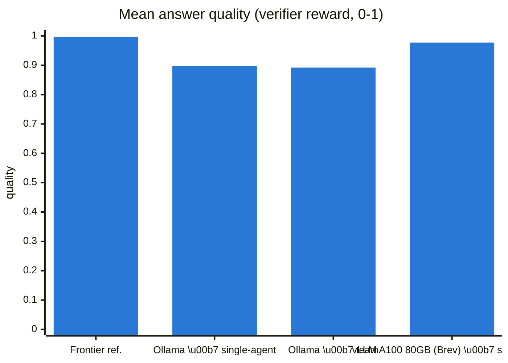
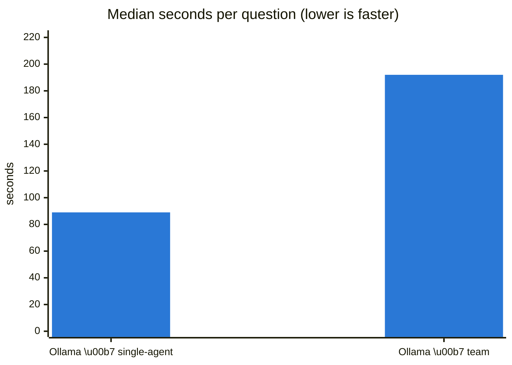
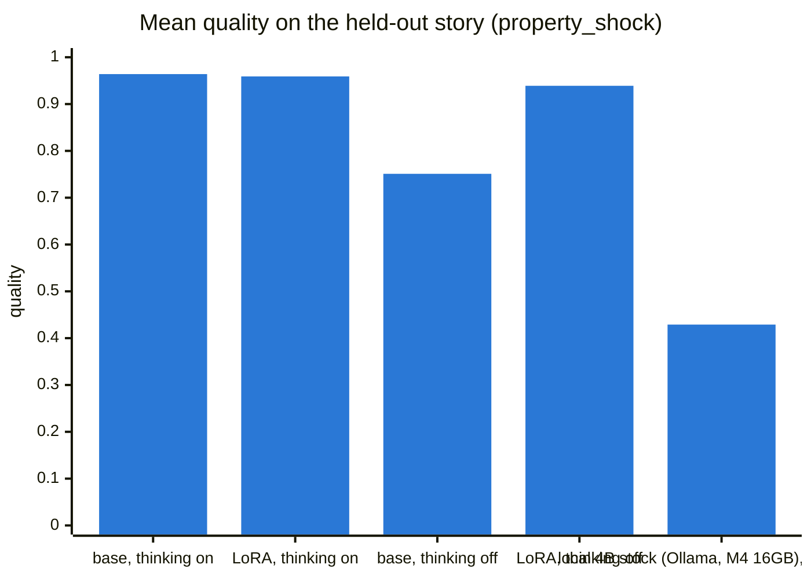

# Model comparison: 15 evaluation-bank questions

Same questions (q01–q15), tools, prompts and verifier (`src/evaluation/verifier.py`) for every configuration. Runs were driven through the demo app's Ask panel and logged by `demo_app/runlog.py`. Quality is the verifier reward (0–1): correct facts, grounding, tool choice, valid calls, efficiency. A run that gave up scores 0. Answers for review: [RESPONSES.md](RESPONSES.md).

| Configuration | Model | Agents | Answered | Mean quality | Fully right | Median time / question | Median model time | Total | Failed | Truncated prompts |
|---|---|---|---|---|---|---|---|---|---|---|
| **Frontier reference** (Claude Opus 5.5, hand-driven) | claude-opus-5-5 | single | 15 | **0.997** | 13 / 15 | n/a | n/a | n/a | 0 | 0 |
| nemotron-3-nano 4B 32k \| Ollama \| single-agent \| M4 16GB | `nemotron-3-nano-4b-32k` | single | 15 | **0.898** | 10 / 15 | 89.0 s | 88.3 s | 23.6 min | 0 | 0 |
| nemotron-3-nano 4B 32k \| Ollama \| team \| M4 16GB | `nemotron-3-nano-4b-32k` | team | 15 | **0.892** | 10 / 15 | 192.4 s | n/a | 59.5 min | 0 | 0 |
| nemotron-3.5-lightning 30B BF16 base \| vLLM A100 80GB (Brev) \| single-agent \| NeMo Gym | `nvidia/NVIDIA-Nemotron-3.5-Lightning-30B-A3B-BF16` | single | 15 | **0.977** | 10 / 15 | n/a | n/a | n/a | 0 | 0 |

*nemotron-3-nano 4B 32k \| Ollama \| team \| M4 16GB*: quality credits the specialists' tool calls, verified from the tool-call log for 9 delegated answers (the scorer only saw the orchestrator's `ask_<specialist>`); as first scored: 0.832. Median model time is n/a because those runs only timed the orchestrator's turns.

## Charts

Configurations without a time bar have no comparable per-question time: the frontier reference was driven by hand, and NeMo Gym rollouts do not record wall time per question.

## Quality by question

| Question | Frontier | Ollama · single-agent | Ollama · team | vLLM A100 80GB (Brev) · single-agent |
|---|---|---|---|---|
| q01_previous_allowance: What was the CECL allowance in July 2026? | 1.00 | 1.00 (48 s) | 1.00 (54 s) | 1.00 |
| q02_current_allowance: What was the CECL allowance at the end of August 2026? | 1.00 | 0.45 (71 s) | 0.45 (100 s) | 0.99 |
| q03_dollar_change: By how many dollars did the allowance change from July to August? | 1.00 | 1.00 (45 s) | 1.00 (52 s) | 1.00 |
| q04_pct_change: What was the percentage increase in the allowance between July and August? | 1.00 | 1.00 (35 s) | 1.00 (37 s) | 1.00 |
| q05_drivers: Why did our allowance increase in August? What were the major drivers? | 1.00 | 0.74 (154 s) | 0.86 (195 s) | 0.98 |
| q06_top_portfolio: Which portfolio contributed most to the allowance increase? | 1.00 | 1.00 (64 s) | 1.00 (261 s) | 1.00 |
| q07_top_borrowers: Which borrowers contributed most to the increase? Who should I investigate first? | 1.00 | 1.00 (89 s) | 0.35 (853 s) | 0.91 |
| q08_pd: Did probability of default increase between July and August? | 0.99 | 1.00 (62 s) | 1.00 (265 s) | 1.00 |
| q09_lgd: Did LGD increase, and did it drive the change? | 1.00 | 1.00 (176 s) | 1.00 (298 s) | 0.97 |
| q10_exposure: Did exposure grow? How much new business did we originate? | 1.00 | 1.00 (141 s) | 1.00 (312 s) | 1.00 |
| q11_macro_variable: Which macroeconomic variable had the largest impact on the allowance? | 1.00 | 1.00 (44 s) | 1.00 (192 s) | 1.00 |
| q12_weights: Did the scenario weights change between July and August? | 1.00 | 0.97 (124 s) | 1.00 (121 s) | 1.00 |
| q13_model_change: Could this increase just be because we changed models? | 1.00 | 1.00 (92 s) | 0.90 (168 s) | 1.00 |
| q14_cre: What happened specifically in Commercial Real Estate? | 0.97 | 0.72 (101 s) | 0.82 (545 s) | 0.80 |
| q15_reconcile: Does the attribution reconcile to the total allowance change? | 1.00 | 0.59 (172 s) | 1.00 (120 s) | 1.00 |

Cells: quality (seconds for that question).

## Fine-tuning result: base vs LoRA (held-out story `property_shock`)

Gus's evaluation ([../../../evidence/lora_eval/README.md](../../../evidence/lora_eval/README.md)): base Lightning 30B and the LoRA adapter (`risklens-lora`) served from one vLLM on one H100, same NeMo Gym environment and verifier, 4 attempts per question. The `property_shock` story was never in training and has different correct answers from the base story above, so compare these rows with each other, not with the table above.

The adapter is public on Hugging Face: [gcav66/nemotron-3.5-lightning-risklens-lora](https://huggingface.co/gcav66/nemotron-3.5-lightning-risklens-lora) (PEFT LoRA, rank 16, 45.5 MB; runs on top of `nvidia/NVIDIA-Nemotron-3.5-Lightning-30B-A3B-BF16`).

| On the held-out story | Mean quality | Answers with no tool call | Output tokens / answer |
|---|---:|---:|---:|
| base, thinking on | **0.964** | 0 / 60 | 970 |
| LoRA, thinking on | **0.959** | 0 / 60 | 1,042 |
| base, thinking off | **0.751** | 14 / 60 | 418 |
| LoRA, thinking off | **0.939** | 0 / 60 | 567 |
| local 4B stock (Ollama, M4 16GB), thinking off | **0.429** | 9 / 15 | 219 |

Extra rows ran the same story, Gym harness, verifier and thinking-off setting (Ollama needs its own `reasoning_effort: none`; it ignores `chat_template_kwargs`), with 1 attempt per question.

**Reading:** with thinking on, the adapter changes nothing (0.959 vs base 0.964). With thinking off it lifts quality from 0.751 to 0.939 and stops answers without a tool call (14 → 0 of 60), close to base with thinking on while writing about 42% fewer output tokens (567 vs 970).

### Thinking on

| | base | LoRA |
|---|---:|---:|
| correctness | 0.978 | 0.978 |
| grounding | 0.929 | 0.930 |
| tool selection | 0.983 | 0.917 |
| call validity | 0.919 | 0.939 |
| efficiency | 1.000 | 1.000 |
| tool calls / errors | 97 / 11 | 92 / 9 |

| Question | base | LoRA | change |
|---|---:|---:|---:|
| q01_previous_allowance | 0.993 | 0.978 | -0.015 |
| q02_current_allowance | 1.000 | 0.998 | -0.002 |
| q03_dollar_change | 0.985 | 0.983 | -0.002 |
| q04_pct_change | 0.996 | 0.995 | -0.001 |
| q05_drivers | 0.983 | 0.983 | -0.000 |
| q06_top_portfolio | 0.966 | 0.984 | +0.018 |
| q07_top_borrowers | 0.886 | 0.971 | +0.085 |
| q08_pd | 0.970 | 0.975 | +0.005 |
| q09_lgd | 0.973 | 0.970 | -0.003 |
| q10_exposure | 0.968 | 0.961 | -0.007 |
| q11_macro_variable | 0.955 | 0.869 | -0.086 |
| q12_weights | 1.000 | 1.000 | +0.000 |
| q13_model_change | 0.998 | 0.983 | -0.015 |
| q14_cre | 0.792 | 0.750 | -0.043 |
| q15_reconcile | 0.993 | 0.991 | -0.003 |

### Thinking off

| | base | LoRA |
|---|---:|---:|
| correctness | 0.781 | 0.944 |
| grounding | 0.790 | 0.931 |
| tool selection | 0.717 | 0.850 |
| call validity | 0.758 | 0.982 |
| efficiency | 0.997 | 1.000 |
| tool calls / errors | 82 / 1 | 79 / 3 |

| Question | base | LoRA | change |
|---|---:|---:|---:|
| q01_previous_allowance | 0.504 | 0.994 | +0.490 |
| q02_current_allowance | 0.506 | 0.991 | +0.485 |
| q03_dollar_change | 0.059 | 0.983 | +0.923 |
| q04_pct_change | 0.506 | 0.996 | +0.490 |
| q05_drivers | 0.994 | 0.897 | -0.096 |
| q06_top_portfolio | 0.983 | 0.865 | -0.117 |
| q07_top_borrowers | 0.968 | 0.804 | -0.164 |
| q08_pd | 0.786 | 0.966 | +0.180 |
| q09_lgd | 0.990 | 0.991 | +0.001 |
| q10_exposure | 0.918 | 0.978 | +0.059 |
| q11_macro_variable | 0.296 | 0.896 | +0.600 |
| q12_weights | 1.000 | 1.000 | +0.000 |
| q13_model_change | 1.000 | 0.996 | -0.004 |
| q14_cre | 0.754 | 0.732 | -0.022 |
| q15_reconcile | 1.000 | 0.993 | -0.007 |

