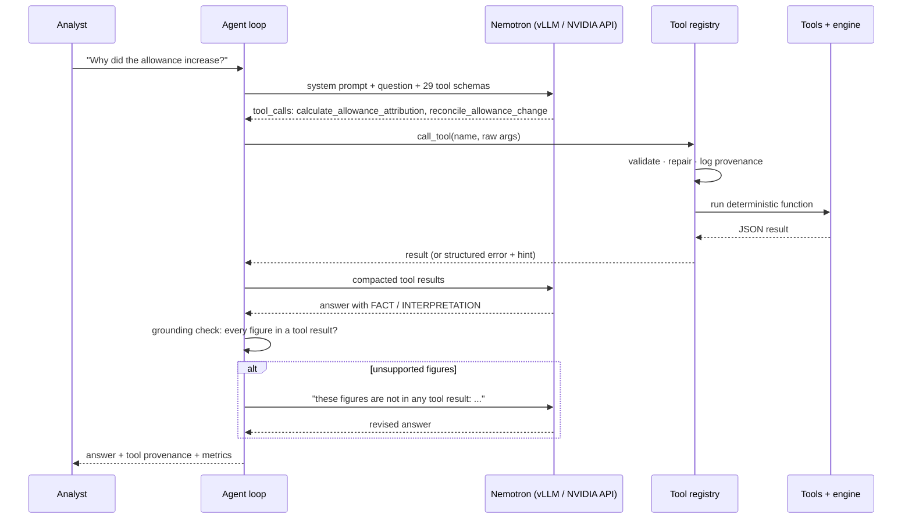

# RiskLens architecture

## The problem

Each month a bank books its CECL allowance. When it moves by $20M, five teams want to know why: Finance has to explain it, Credit Risk wants the borrowers, economists want the macro story, Model Risk wants to rule out a model change, and someone has to make the pieces add up to the booked figure. Today that is spreadsheets and meetings.

RiskLens automates the investigation with a small model that calls deterministic analytics. The design choice that drives everything else: **the model never computes a financial number.** It decides which question to ask the tools, and it explains what comes back.

## Request flow



## Components

### CECL engine (`risklens/cecl/engine.py`)

One vectorised function, `run_cecl(RunInputs) -> RunResult`, over loans × scenarios × years. Inputs are the loan tape, macro deviations (scenario × variable × quarter), scenario weights and overlays; parameters come from `config/methodology.yaml` and `config/models.yaml` keyed by the model id on each loan. That keying is what makes "did a model change?" answerable: a model change is a different id on the loan tape.

The engine is deliberately simple (annual steps, logistic scorecards, linear macro shift, collateral-linked LGD) so every step can be audited. `tests/test_engine.py` re-implements the formula with scalar loops for one loan per product and requires agreement to 1e-6.

### Attribution (`risklens/cecl/attribution.py`)

A movement explanation is only useful if it adds up. Instead of allocating the change with sensitivities and plugging the residual, the engine is re-run for counterfactual states. Each state says which of five input groups have moved to the current period:

| Group | Inputs moved |
|---|---|
| runoff | exits (paid off, matured, charged off) and balance / term changes on surviving loans |
| growth | new originations |
| credit | borrower attributes: FICO, DTI, LTV, DSCR, leverage, rating, watchlist, delinquency |
| macro | the macro scenario paths |
| methodology | scenario weights, model ids, management overlays |

- **Sequential waterfall** (reported): move groups one at a time in the configured order. Components telescope, so they sum exactly to the change between the two re-runs, and those re-runs tie to the booked allowance.
- **Reverse order** and **exact Shapley** (average over all 120 orderings, 32 states): show how much the split depends on order. Credit and macro interact (a weaker borrower costs more under a worse forecast), so the split moves by about $0.8M between methods; the primary driver does not.
- **Macro by variable**: exact Shapley over the six variables (64 states), starting from the waterfall's state just before the macro step, so the variable contributions sum to the macro component.
- **By portfolio and by loan**: every state keeps per-portfolio and per-loan ECL, so the same waterfall answers "which segment" and "which borrower" consistently.

All evaluations are cached on disk keyed by a hash of the data and methodology (`data/outputs/cache/`).

### Reconciliation control

`reconcile_allowance_change` compares the **booked** change (from `run_manifest.json`) with the sum of the attributed components. The residual is measured, never forced to zero; here it is the rounding of booked figures to cents. Status thresholds live in `config/reconciliation.yaml` (PASS ≤ 0.1%, WARNING ≤ 1%, else FAIL). It also checks that the opening and closing re-runs tie to the booked runs, and downgrades PASS to WARNING if the primary driver differs between sequential, reverse and Shapley.

### Tools (`risklens/tools/`)

29 functions registered with `@tool(category)`. The decorator builds the OpenAI function schema from the signature and docstring. `call_tool` is the only entry point an agent uses:

1. Unknown tool → error with `did_you_mean`.
2. Arguments as a JSON string → parsed. Invalid JSON → error with the expected schema.
3. Unknown argument names → renamed to the closest real parameter, or dropped (logged).
4. Typed repair: dates (`"Aug 2026"`, `"2026-08"`, `"current"`), portfolios (`"cre"`, `"commercial real estate"`), scenarios (`"severe"`), numbers given as strings.
5. Missing comparison dates default to the standard comparison (logged as a repair).
6. Domain errors raise `ToolError(message, hint)`: wrong date order → `swap_to`; unknown date → `available_dates`; unknown model → `available_models`.
7. Every call is logged with provenance: call id, tool, cleaned arguments, timestamp, sha256 of the result, duration and repairs (`data/outputs/tool_calls.jsonl`).

Tools read only the published datasets through `DataStore`. They never read `ground_truth.json` (tested).

### Agent (`risklens/agents/agent.py`)

`InvestigatorAgent.run(question)` runs at most 8 model turns and 14 tool calls:

- Structured tool calls are used when the server returns them. If the model writes a call as text, it is parsed: `<tool_call>{json}</tool_call>`, Qwen3-coder XML (`<function=…><parameter=…>`), or a fenced JSON block naming a known tool.
- Up to 6 calls per turn run in order; identical repeated calls are answered from cache and counted.
- Results are compacted before going back to the model (long lists trimmed, bulkiest fields dropped), keeping prompts small.
- The final answer goes through `grounding.check`: numbers are parsed with their units ($, M, K, B, %, pp, bps) and matched against every number in this run's tool results (including figures embedded in reason strings), with a tolerance equal to the displayed precision. Dates, ids, model versions and small list numbers are ignored. Unsupported figures produce one revision turn.
- If the model returns nothing usable, a deterministic summary of the tool results is returned and `fallback_used` is counted.
- `AgentRun` keeps every step, provenance record and counter; `metrics()` reports tool success rate, argument validity, repairs, recoveries, text-parsed calls, duplicates, grounding revisions, fallbacks, tokens and latency.

### LLM providers (`risklens/llm/`)

`get_provider()` returns one of:

| Provider | Endpoint | Use |
|---|---|---|
| `vllm` | self-hosted vLLM on NVIDIA Brev (`deploy/brev_serve_nemotron.sh`) | main demo: local inference, data stays on the GPU instance |
| `nvidia` | NVIDIA API catalog | quick start without a GPU |
| `openai` | any OpenAI-compatible endpoint | comparison runs |
| `mock` | in-process keyword planner | tests and offline demos |

All real backends share `OpenAICompatProvider`, so switching models is configuration. For Nemotron, `chat_template_kwargs.enable_thinking` is passed (configurable); vLLM uses the `qwen3_coder` tool parser and `nemotron_v3` reasoning parser from the vLLM recipe for this model.

## Why NVIDIA Nemotron + vLLM

- **Size and speed:** Nemotron 3.5 Lightning has 30B total parameters (within the 33B rule) with about 3B active per token, so it is fast enough for an interactive tool loop of several turns on a single GPU.
- **Tool calling built in:** the vLLM recipe exposes it through the OpenAI tool-calling API, which is all the agent needs.
- **Data stays put:** a bank cannot send loan-level data to a public API. Serving the model with vLLM (the engine behind Red Hat AI Inference Server) on our own Brev instance is the deployment pattern a regulated institution would actually use. Only tool results, never raw data, reach the model.

## Design decisions

| Decision | Why |
|---|---|
| Model never computes numbers | Small models make arithmetic mistakes; auditors need every figure traceable to code |
| Counterfactual re-runs instead of sensitivities | Exact reconciliation without a plug; residual stays a real control |
| Report three attribution methods | Interaction effects make any single order debatable; showing all three is honest |
| Repair arguments instead of rejecting | Most small-model failures are formatting; repairing them keeps the loop moving and the log shows what was fixed |
| Grounding check on every answer | Catches the most damaging failure (a plausible invented number) before a user sees it |
| Mock planner speaks the same protocol | The whole pipeline is testable in CI without a GPU or API key |
| All tunables in YAML | Story, methodology and thresholds can change without code changes |
| Synthetic data with hidden ground truth | Lets us measure whether the agent finds the real cause |

## Repository layout

```
config/          settings, methodology, models, story (injected scenario), reconciliation, agents
risklens/
  cecl/          engine.py, attribution.py
  data/          generator.py (seeded synthetic data), store.py (read access)
  tools/         registry.py + allowance / portfolio / credit / macro / model / reconciliation tools
  llm/           provider.py (NVIDIA API, vLLM, OpenAI-compatible), mock.py
  agents/        agent.py (tool loop), grounding.py
scripts/         generate_data, precompute, report, ask, check_llm, evaluate
deploy/          brev_serve_nemotron.sh
data/published/  the synthetic dataset (committed)
tests/           data, engine (scalar cross-check), attribution vs ground truth, reconciliation, tools, agent
docs/            ARCHITECTURE.md, DATA.md, SUBMISSION.md
```
