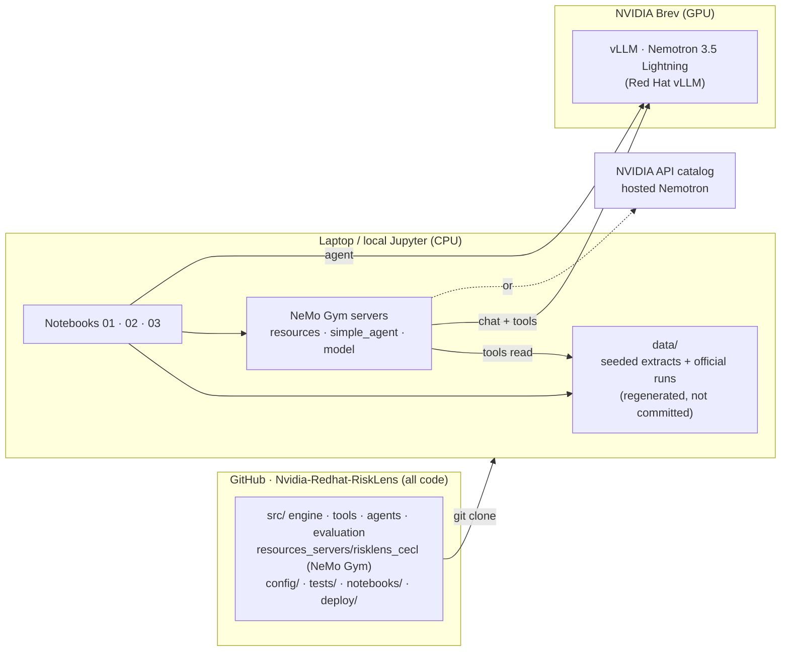
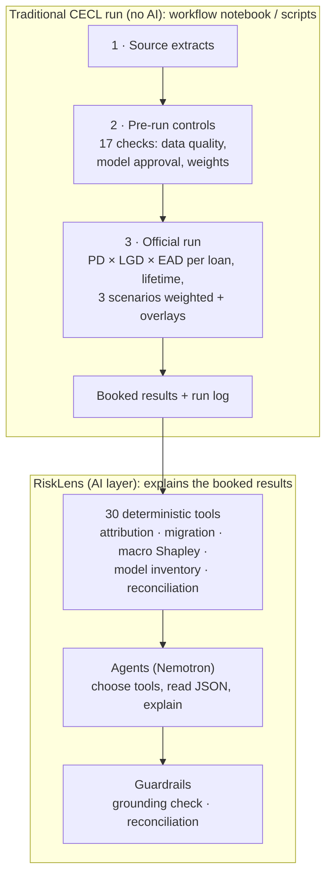
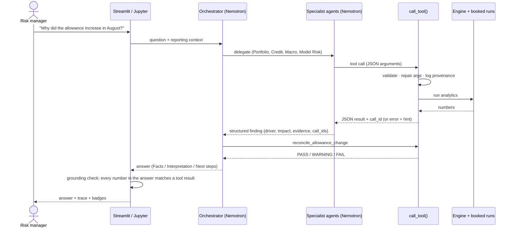
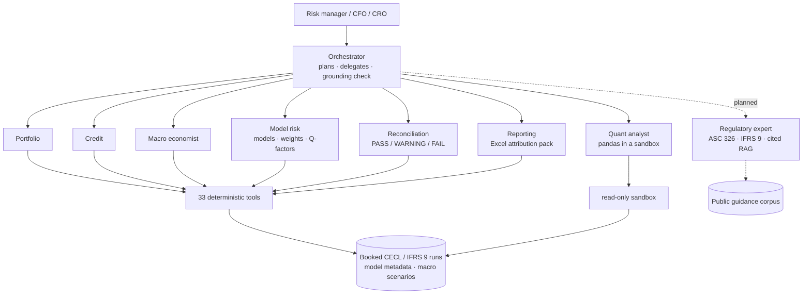
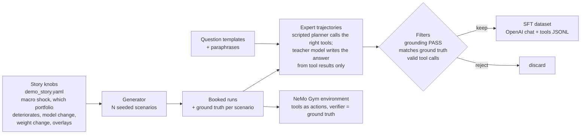

# RiskLens AI: how the whole project fits together

*Team guide for the NVIDIA × Red Hat Small Models Hack. Read this first, then `README.md` (how to run) and `docs/ARCHITECTURE.md` (engine and tool internals).*

**One sentence:** the bank's CECL run produces the numbers, deterministic tools expose them, and small Nemotron agents decide which tools to call and explain the result. Every figure an agent writes is checked against a tool result.

---

## 1. System map



| Place | What lives there | Who changes it |
|---|---|---|
| **GitHub** `Luizkauffmann/Nvidia-Redhat-RiskLens` | All code, config defaults, tests, notebook builder + notebooks, Gym environment, deploy scripts, docs. CI runs `pytest` on every push | Everyone, via branches and pull requests |
| **Local checkout** `data/` | The demo bank's data: extracts, official runs, caches, agent and Gym logs, ground truth. Seeded, so it's identical on every machine; never committed | `scripts.generate_demo_data` or the first notebook cell |
| **Local Jupyter** | Three notebooks: traditional CECL run, agent, NeMo Gym environment. They also run in Colab (the first cell clones the repo) | Run by anyone; generated by `scripts/build_notebooks.py` |
| **Brev (GPU)** | Nemotron served by vLLM (`deploy/brev_serve_nemotron.sh`); later fine-tuning jobs | Whoever owns the GPU workstream |
| **NVIDIA API catalog** | Hosted Nemotron 3.5 Lightning for development and as a fallback | Nobody (managed service) |

Rule of thumb: **code in GitHub, data regenerated locally from the seed, model on Brev (or the NVIDIA API).** Secrets live in `.env` (copy `.env.example`), never in notebooks or commits.

---

## 2. Data inputs

A seeded generator stands in for the bank's systems. Because it's seeded, the data is identical everywhere (laptops, Brev, Colab), and on Brev you can regenerate it instead of copying it: `python -m scripts.generate_demo_data`.

| Input (`data/`) | Stands in for | Used by |
|---|---|---|
| `loan_snapshots.parquet` (about 50k loans per month, 38 fields) | Loan servicing / core banking extract | Engine, portfolio and credit tools |
| `counterparties.parquet` | Borrower master, credit bureau, financial spreading | Credit tools, borrower drill-downs |
| `macro_scenarios.csv` | Economic forecast vendor (baseline / adverse / severe, 8 quarters) | Engine, macro tools |
| `scenario_weights.csv`, `management_overlays.csv` | ALLL committee decisions | Engine, model-risk tools |
| `model_metadata.csv`, `model_assignments.csv` + `config/models.yaml` | Model risk inventory and scorecard parameters | Engine, model-risk tools, pre-run controls |
| `ecl_results.parquet`, `allowance_summary.csv`, `run_log.csv` | **Outputs** of the official run (the booked allowance) | Every tool; reconciliation compares against these |
| `evaluation/ground_truth.json` | The story we injected (what really caused the change) | **Scoring only.** Tools and agents never read it (a test enforces this) |

`databank/` holds the same tables as CSV per reporting date, with a data dictionary, for people to browse in a spreadsheet (`data/outputs/databank/`).

**Swapping in real data later (e.g. from Dataiku):** write extracts with the same columns into a folder, point `RISKLENS_DATA_DIR` at it, run the workflow notebook. No code changes.

---

## 3. The traditional run vs the agents



The agents **never calculate CECL**. They can only call tools, and tools only read the booked run (or re-run the engine for what-ifs). That is the core of the pitch: *small models don't need to know everything, they need to know which risk tool to call next.*

---

## 4. How a question gets answered



### The team (Phase 4, built)



All roles run on one Nemotron 3.5 Lightning base (30B total / 3B active), so the system stays within the 33B limit. Each role differs only in prompt, tool allow-list and (later) a LoRA adapter.

**Phase 3 (built):** one orchestrator with all 30 tools (`src/agents/orchestrator.py`).

**Phase 4 (next):** specialists reuse the same `ToolAgent` loop with their own tool allow-list (11–15 tools each, `config/agents.yaml`) and a short role prompt. They return structured findings; the orchestrator plans, delegates, asks the Reconciliation Agent to check the totals, and writes the answer. Fewer tools per agent means shorter prompts and better tool choice from a small model. That's the Multi-Agent track argument.

| Agent | Answers | Key tools |
|---|---|---|
| Orchestrator | What to investigate, final explanation | delegates; `calculate_portfolio_attribution` |
| Portfolio | Growth, runoff, exposure, segment mix | `calculate_balance_change`, `calculate_new_originations`, `calculate_paydowns` |
| Credit | Which borrowers deteriorated and why (PD vs LGD) | `identify_top_contributors`, `compare_borrower_periods`, `calculate_pd_migration` |
| Macro | Which variable, which portfolio, sensitivities | `calculate_variable_attribution` (Shapley), `calculate_segment_macro_sensitivity` |
| Model Risk | Model versions, parameters, weights, overlays | `compare_model_versions`, `compare_scenario_weights` |
| Reconciliation | Does it add up? Is the main driver robust? | `reconcile_allowance_change` |

---

## 5. Calling Nemotron

All backends speak the OpenAI chat API with tool calling, so the agent code is identical everywhere. Switch with one setting (`config/agents.yaml → llm`, or env vars).

| Backend | When | Endpoint | Model id |
|---|---|---|---|
| `nvidia` | Development, fallback | `https://integrate.api.nvidia.com/v1` + `NVIDIA_API_KEY` | `nvidia/nemotron-3.5-lightning-30b-a3b` |
| `vllm` | **Demo and bounties** (Nemotron on Red Hat vLLM, on Brev) | `http://<brev-host>:8000/v1` (`deploy/brev_serve_nemotron.sh`) | `nvidia/NVIDIA-Nemotron-3.5-Lightning-30B-A3B-NVFP4` |
| `mock` | Tests, CI, offline demo | none | deterministic keyword planner |

```bash
python -m scripts.check_llm --provider vllm --base-url http://<brev-host>:8000/v1   # smoke test first
python -m scripts.ask "Which borrowers should I investigate?" --provider vllm --trace
```

Model facts: 30B total / 3B active (mixture of experts), within the 33B limit. vLLM flags: `--enable-auto-tool-choice --tool-call-parser qwen3_coder --reasoning-parser nemotron_v3`. Thinking mode is on by default (`enable_thinking`), which is slower but plans better.

**Open question for the organizers:** does the 33B limit count the whole system or each model? With one shared Lightning base serving every agent, we're at 30B either way. A second base model would break the limit under the "whole system" reading.

---

## 6. Making the agents smart

Most of the intelligence is engineering around the model, not inside it. Work through these levels in order; each is useful on its own, and later levels depend on the evaluation in level 3.

| Level | What | Status |
|---|---|---|
| **0 · Tools do the thinking that must be exact** | Attribution, Shapley, migrations, reconciliation are code. The model never does arithmetic | ✅ done |
| **1 · Prompts and playbooks** | Role prompts per agent, tool descriptions written for a small model, investigation playbooks ("allowance up → attribution → largest driver → drill into its segment → reconcile") and 2–3 worked examples in the prompt | Partly done (orchestrator); specialists next |
| **2 · Guardrails** | Argument repair, error hints, duplicate-call suppression, step limits, grounding check with a revision turn, reconciliation control | ✅ done |
| **3 · Evaluation harness** | Question bank scored against ground truth (see below). **Nothing gets tuned without a score** | Next, before any fine-tuning |
| **4 · Fine-tuning (SFT / LoRA)** | Teach the model *our* investigation style from synthetic expert trajectories | ✅ LoRA SFT on 401 of Nemotron's own passing rollouts (+ hint distillation): held-out no-reasoning mode 0.751 → 0.939; no gain with reasoning on ([evidence](../evidence/lora_eval/README.md)) |
| **5 · RL in NeMo Gym** | Reward the model for reaching the right conclusion with valid, efficient tool calls | Design + small demo; full training after the event |

### 6.1 Evaluation harness (level 3)

We own the simulator, so we know the right answer to every question.

| Metric | Measured how |
|---|---|
| Answer correctness | Facts in the answer vs `ground_truth.json` (primary driver, primary portfolio, top macro variable, largest borrower, model changed?, weights changed?, reconciliation status) |
| Tool selection | Expected tools called (e.g. a borrower question must hit `identify_top_contributors`) |
| Argument validity | % of calls that pass validation first time; % repaired; % recovered after an error |
| Grounding | % of answers whose numbers all trace to tool results |
| Efficiency | Tool calls, model turns, tokens, seconds per question |

Run it for: mock planner (floor), Nemotron with thinking off, with thinking on, single agent vs multi-agent, base vs fine-tuned. That table is the evidence the judges asked for ("evidence that specialization beats general-purpose").

### 6.2 Training data factory (feeds levels 4 and 5)



- **Vary the story** so the model learns to *investigate*, not to memorise "macro, CRE, unemployment": some scenarios are credit-led, some growth-led, some have a real model change, some C&I deteriorates instead of CRE.
- **Include recovery examples:** a bad argument, the tool's hint, then the corrected call. Small models learn tool-calling habits from these.
- **Teacher model:** a larger model may *write* training answers offline, but only from tool results, and only answers that pass the grounding check and match ground truth are kept. The model we ship stays ≤ 33B.

### 6.3 Fine-tuning plan (level 4) and compute reality

- NVIDIA's published RL recipe for Nemotron 3.5 Lightning runs on **32 H100s (DAPO) to 344 GB200s (full RLVR)**. That isn't possible on hackathon credits, so **full RL is out of scope this weekend.**
- Realistic for one Brev GPU: **LoRA SFT** on the trajectory dataset (1–2 epochs). **Verified** with `scripts/finetune_lora.py --smoke` on the BF16 base, one A100 80 GB (transformers 5 + PEFT): peak 68.7 of 79.3 GiB, ~6.3 s per ~13k-token example (≈1.75 h for 500 rows × 2 epochs). LoRA covers attention, Mamba `in_proj` and the shared experts; the routed experts stay frozen (fused params) and PEFT rejects Mamba `out_proj`. A 48 GB card is not enough (BF16 weights alone are ~60 GB; QLoRA would not quantize the fused experts).
- Most of each row is the system prompt + 30 tool schemas (~10k tokens); only ~190 tokens per row are trained. Per-specialist tool subsets would roughly halve training time.
- Publish the adapter and dataset card on Hugging Face (required by the Fine-Tuned track), and serve it with vLLM's LoRA support (one base model, one adapter per specialist, if vLLM supports LoRA for this architecture).

### 6.4 NeMo Gym environment (level 5, "Best use of NeMo Gym" bounty) — built

`resources_servers/risklens_cecl` is a NeMo Gym resources server (v0.7). The actions are our 30 tools (`POST /<tool>`); each dataset row is one investigation question with its expected facts; `/verify` scores the final answer. Full description in [`NEMO_GYM.md`](NEMO_GYM.md).

| Reward component (weight) | Signal |
|---|---|
| correctness (0.55) | share of the task's answer checks passed (driver, portfolio, variable, borrower, model change, weights, reconciliation, key figures) |
| grounding (0.20) | share of numbers in the answer found in this episode's tool outputs |
| tool_selection (0.10) | required tools called |
| call_validity (0.10) | share of calls that executed without error |
| efficiency (0.05) | 1 within the task's call budget, budget/calls beyond |
| × 0.25 | no successful tool call (answers recalled from memory don't pay); 0 with no answer |

Status: runs end to end with `gym env start` + `gym eval run` (mock planner 0.965 mean reward on 21 train rows; base Nemotron 3.5 Lightning 0.977 on the 15 demo questions, [evidence](../evidence/nemotron_baseline/README.md)). Five story variants built and checked against their design ([`NEMO_GYM.md`](NEMO_GYM.md#story-variants)). Next: Nemotron rollouts on the variants, SFT export of passing rollouts (`src/evaluation/trajectories.py`), full LoRA run, re-score; specialist datasets; GRPO with NeMo RL after the event.

---|---|
| Correct conclusion | +1 per ground-truth fact stated correctly (driver, portfolio, variable, borrower, model change, reconciliation) |
| Grounded | answer passes the grounding check (else large penalty) |
| Valid tool use | penalty per invalid / malformed call; small bonus for recovering |
| Efficiency | small penalty per tool call beyond what's needed |

For the hackathon: package the environment and verifier, run Nemotron through it as an **evaluation**, and show the reward curve for a handful of steps if compute allows. The full RL run is the post-hackathon roadmap. *(The NeMo Gym environment and verifier API details still need checking against the NeMo Gym docs on the day.)*

---

## 7. Hackathon tracks this covers

| Track / bounty | Our evidence |
|---|---|
| **Multi-Agent Systems** (primary) | Orchestrator + 5 specialists with narrow tool lists, structured findings, reconciliation agent checking the others |
| **Tool-Calling** | 30 typed tools, argument repair, structured error hints, text tool-call parsing, metrics per run (`AgentRun.metrics()`) |
| **Fine-Tuned & Specialized** (stretch) | LoRA on synthetic CECL investigation trajectories, published on Hugging Face, scored with the eval harness |
| **Best use of Nemotron 3.5 Lightning** | Every agent runs on it; thinking mode for planning |
| **Best use of Red Hat vLLM** | Self-hosted on Brev with tool and reasoning parsers |
| **Best use of NeMo Gym** | Verifiable-reward CECL investigation environment built from our simulator |

---

## 8. How the team works

**Setup (each person, 10 minutes)**
1. `git clone https://github.com/Luizkauffmann/Nvidia-Redhat-RiskLens && cd Nvidia-Redhat-RiskLens`
2. Python 3.13 venv (NeMo Gym needs ≥ 3.13.14): `uv venv --python 3.13 .venv && source .venv/bin/activate && uv pip install -r requirements-gym.txt`
3. `python -m scripts.generate_demo_data && python -m pytest -q`
4. `cp .env.example .env` and fill in `NVIDIA_API_KEY` and/or `RISKLENS_VLLM_URL`. Never paste keys into cells, chats or commits.
5. `jupyter lab notebooks/` and run 01 → 02 → 03.

**Rules**
- Branch per task (`feat/streamlit-ui`, `feat/specialists`, `feat/eval`), pull request into `main`, CI must pass. Small PRs; `main` must always demo.
- Numbers come only from `src/tools`. If an agent needs a new number, add a tool (with a test), never prompt the model to compute it.
- Changing the story or calibration → regenerate data → re-run `tests/test_attribution.py`.
- Notebooks are generated: edit `scripts/build_notebooks.py`, run `python -m scripts.build_notebooks`, commit both (outputs cleared).
- Hackathon rule: everything is built in this repo during the event; the only pre-existing code is the single import commit.

**Suggested split (up to 3 people)**

| Workstream | Owns | First deliverable |
|---|---|---|
| A · Model & agents | Brev + vLLM, Phase 4 specialists, prompts/playbooks | `check_llm` green on Brev; multi-agent answers the 15 demo questions |
| B · Product & demo | Streamlit app (KPIs, waterfall, chat, tool trace, badges), pitch | Clickable demo on mock, then on Nemotron |
| C · Evaluation & training | Eval harness, scenario variants, trajectory data, LoRA / NeMo Gym | Baseline score table for the pitch |

**Weekend timeline**

| When | Milestone |
|---|---|
| Sat morning | Brev up, vLLM serving Nemotron, `check_llm` green; eval question bank drafted |
| Sat midday | Specialists + orchestrator delegation; Streamlit skeleton on mock |
| Sat afternoon | Eval baseline (mock vs Nemotron, single vs multi-agent); app on live Nemotron |
| Sat night | Scenario variants + trajectory dataset; start LoRA run (if feasible); NeMo Gym environment |
| Sun morning | Score base vs tuned; freeze `main`; rehearse the demo |
| Sun 4 pm | Submit: repo, HF artifacts, demo video / live demo |

---

## 9. Status (keep updated)

| Phase | | |
|---|---|---|
| 1 Data + engine + attribution | ✅ | CECL $99.06M → $118.30M (+$19.24M), residual $0 |
| 2 Tools (30) | ✅ | provenance, repair, Shapley robustness |
| Notebooks (workflow, agent + team, NeMo Gym) | ✅ | local + Colab (rehearsed on Python 3.12, fresh clone) |
| 3 Orchestrator agent + grounding | ✅ | tested with mock and scripted endpoints; **live Nemotron run pending** (needs NVIDIA key / Brev) |
| 4 Specialists + team | ✅ | orchestrator delegates; quant sandbox; Excel pack; Nemotron run pending |
| 5 Streamlit app | next | |
| 6 Nemotron on Brev vLLM | waiting for access | `deploy/brev_serve_nemotron.sh` ready |
| 7 Evaluation + NeMo Gym environment | ✅ | mock baseline 0.965; Nemotron scores next |
| 7b Fine-tuning / RL | LoRA done; RL not started | Full LoRA run on one A100 (102 steps, 67 min); adapter served next to the base in vLLM and scored in Gym on the held-out story ([evidence](../evidence/lora_eval/README.md)). Adapter published: [gcav66/nemotron-3.5-lightning-risklens-lora](https://huggingface.co/gcav66/nemotron-3.5-lightning-risklens-lora). Next: more weight on the CRE drill-down; GRPO after the event. Section 6.3 |

*Sources for the Nemotron and NeMo facts above: the NVIDIA Nemotron 3.5 Lightning model card on Hugging Face, build.nvidia.com, the NeMo RL "Nemotron 3.5 Lightning" guide, and the NeMo Gym docs.*
